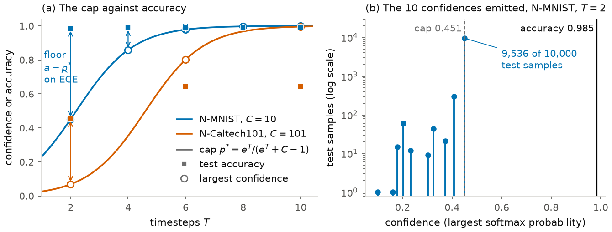
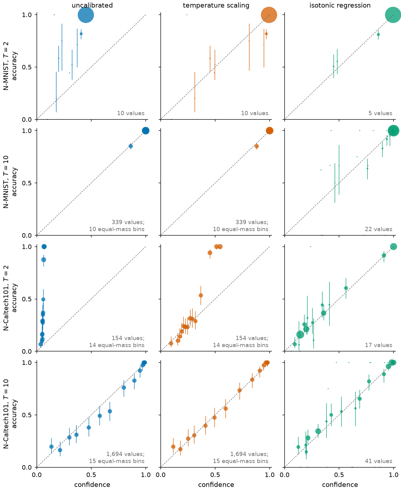
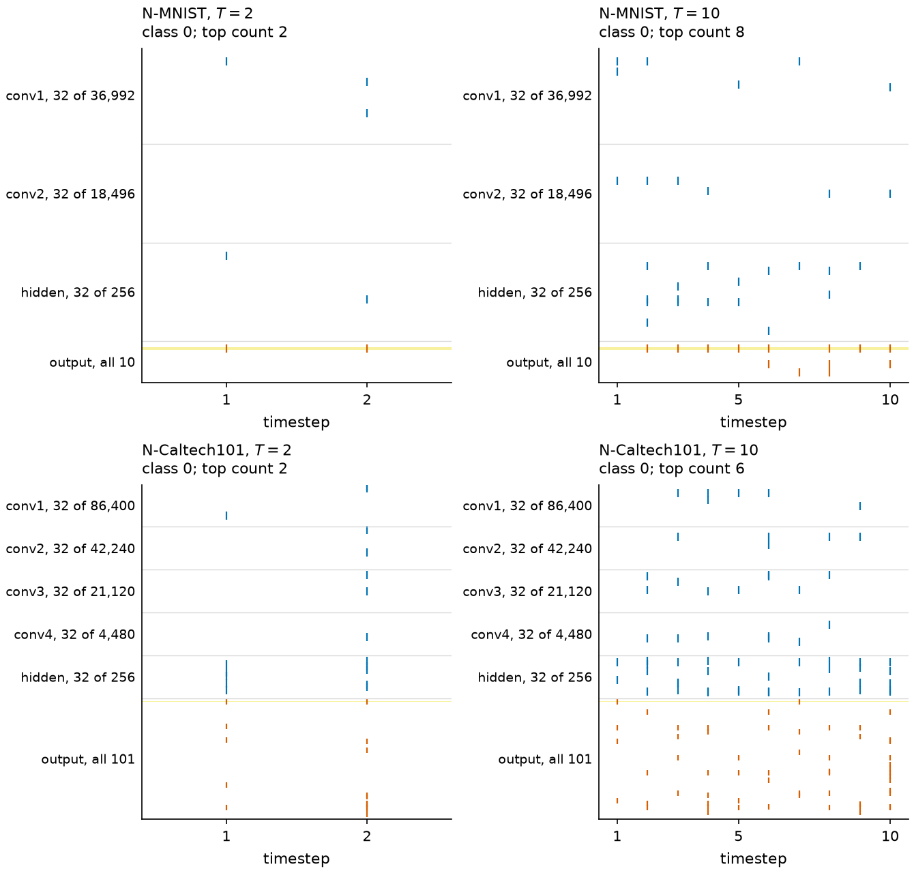
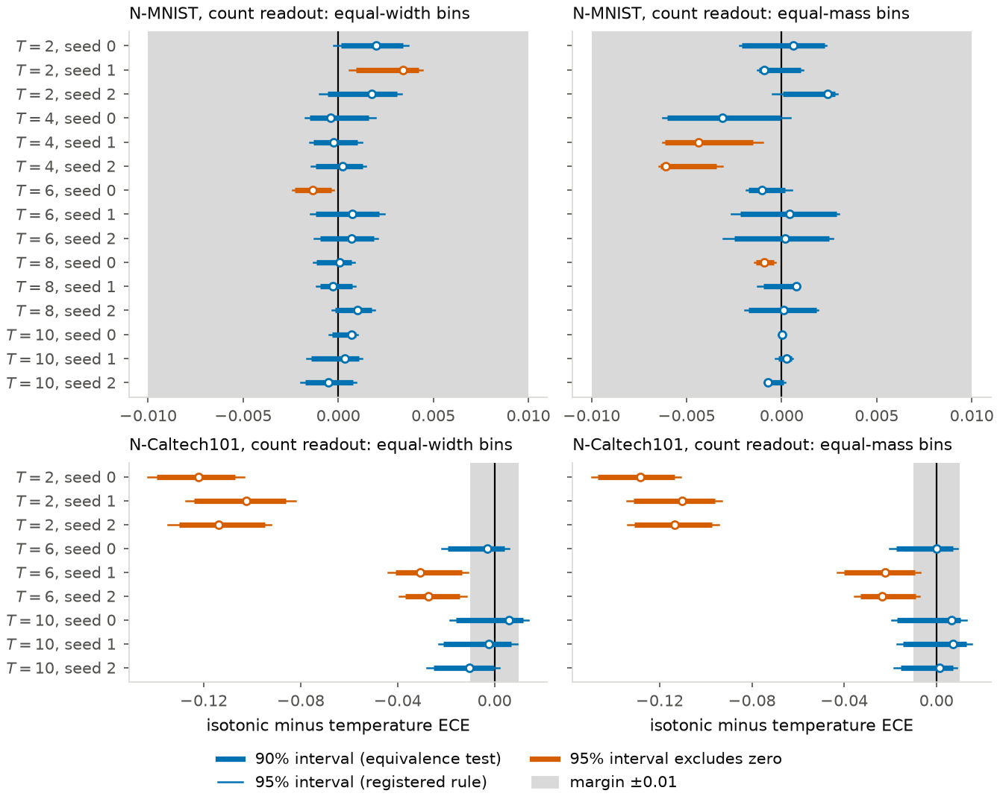

# Counting Spikes Caps Confidence

**The Calibration Cost of a Known Softmax Bound in Low-Timestep Spiking Networks**

Mohammed Abrar Ahasan Chowdhury ([ORCID 0009-0006-9273-6593](https://orcid.org/0009-0006-9273-6593)),
Md Mahmudul Hasan ([ORCID 0000-0003-2543-3112](https://orcid.org/0000-0003-2543-3112)) and
Pedro Machado ([ORCID 0000-0003-1760-3871](https://orcid.org/0000-0003-1760-3871))

[](https://github.com/abrarahasanadil/spikecalib/actions/workflows/tests.yml)

Paper: [paper/main.pdf](paper/main.pdf). Release: v1.0.0.

A softmax over spike counts collected over *T* timesteps can never be more confident than
*e<sup>T</sup>/(e<sup>T</sup>+C−1)* for *C* classes, a bound already known for normalised and
clipped logits, so wherever a spiking network is more accurate than that cap its expected
calibration error (ECE) has a provable floor. This repository measures that floor and what
follows from it on N-MNIST and N-Caltech101 at 2 to 10 timesteps, with three seeds per setting,
and holds the code, run records and result files behind every number in the paper.



## Headline results

Every number below is generated from `results/` by `paper/make_numbers.py`; the comment beside
each names its macro in `paper/numbers.tex`, and `tests/test_readme.py` checks that they agree.
Means are over three seeds; ECE is under equal-width binning, 15 bins.

| quantity | N-MNIST | N-Caltech101 |
|---|---|---|
| cap *p*\* at *T* = 2 | 0.4509 <!-- n:ceilTenTwo --> | 0.0688 <!-- n:ceilHundredOneTwo --> |
| test accuracy of the count readout at *T* = 2 | 0.9850 <!-- n:swAccTwo --> | 0.4543 <!-- n:ccAccTwo --> |
| floor *a* − *p*\* as a share of the observed ECE at *T* = 2 | 99.17% <!-- n:frNmTwoW --> | 97.10% <!-- n:frNcTwoW --> |
| ECE at *T* = 2, uncalibrated | 0.5386 <!-- n:hdNmTwoUncW --> | 0.3969 <!-- n:hdNcTwoUncW --> |
| ECE at *T* = 2, temperature scaling | 0.0018 <!-- n:hdNmTwoTempW --> | 0.1449 <!-- n:hdNcTwoTempW --> |
| ECE at *T* = 2, isotonic regression | 0.0042 <!-- n:hdNmTwoIsoW --> | 0.0320 <!-- n:hdNcTwoIsoW --> |
| count runs where isotonic regression is better under the registered rule; N-Caltech101 also with the calibration set reweighted to the test classes | 0 <!-- n:resolveBoth --> of 15 <!-- n:tostNmRuns --> | 5 <!-- n:ncDiffer --> of 9 <!-- n:tostNcCountRuns -->; 4 <!-- n:rwCountIso --> of 9 |
| AUROC of confidence for correctness at *T* = 2, uncalibrated: count, accumulator trained separately | 0.9204 <!-- n:hdAurocCount -->, 0.9698 <!-- n:hdAurocAccum --> | 0.8593 <!-- n:hdNcAurocCount -->, 0.8885 <!-- n:hdNcAurocAccum --> |
| accuracy at *T* = 2: count, accumulator on the same weights, accumulator trained | 0.9850 <!-- n:swNmTwoCountAcc -->, 0.9868 <!-- n:swNmTwoAccumAcc -->, 0.9861 <!-- n:swNmTwoTrainedAcc --> | 0.4543 <!-- n:swNcTwoCountAcc -->, 0.5744 <!-- n:swNcTwoAccumAcc -->, 0.5825 <!-- n:swNcTwoTrainedAcc --> |

The bound is respected in **36 of 36** distinct count-readout cells <!-- n:cellsUnion -->. Of the
25 <!-- n:predictionsEverything --> predictions and prediction parts recorded before the
experiments that tested them, 13 <!-- n:predictionsEverythingHeld --> held and
12 <!-- n:predictionsEverythingFalsified --> failed; all are reported.

## What the paper shows

- Reading a spike count as a bounded logit turns a known softmax bound into a floor on ECE under
  any binning. At *T* = 2 that floor is nearly all of the observed error on both datasets.
- Temperature scaling, which lifts the cap without retraining, removes the underconfidence on
  N-MNIST and most of it on N-Caltech101. Lifting the cap far above accuracy, by an accumulating
  readout or a learned scale, makes N-Caltech101 overconfident.
- Most of the accuracy a count readout gives up on N-Caltech101 at *T* = 2 is lost at the readout
  at inference, to coarse and tied counts, and is present with identical weights.
- On N-MNIST temperature scaling and isotonic regression both reach low error and differ little.
  On N-Caltech101 at *T* = 2 no single temperature removes the count readout's error, and
  isotonic regression does better in every seed, also with the calibration set reweighted to the
  test class distribution; for the other readouts there the comparison depends on the
  calibration set (nine runs of one architecture per readout).
- A count readout emits at most binom(*T*+*C*−1, *C*−1) distinct confidences at any scale; on
  N-MNIST at *T* = 2 its ties lower its AUROC below that of an accumulator reading the same
  weights.
- An exploratory fusion pilot, with synthetic degradation of a single sensor, shows two saturated
  count readouts that the product rule cannot weight; it is not evidence about real multimodal
  fusion.

Prior work had stated the bound for normalised and clipped logits, observed early
underconfidence of spike-count readouts at long simulations, and temperature-scaled unbounded
readouts of converted networks; the paper's Related work and its literature-search appendix
give the comparison.

## Figures

| | |
|---|---|
|  | Reliability diagrams of the count readout before and after each calibrator, per distinct confidence value. |
|  | Spike rasters of one test sample per dataset at *T* = 2 and *T* = 10, from the saved weights. |
|  | Isotonic minus temperature ECE per run, with the 95% interval of the registered rule and the 90% interval of the equivalence test. |

## Reproduce

Hardware: training ran on Apple silicon through PyTorch's MPS backend; the post-review analyses
ran on an Apple M1 Max with 32 GB of memory. The recorded training time of the 105
<!-- n:modelsTotal --> models of the main study is 9.7 <!-- n:trainHoursAll --> hours; the
post-review retraining of the learned scale is recorded separately in
`results/scale_convergence.json`. Everything except training and inference runs on the CPU and
is deterministic.

**Environment.** Python 3.13.1; every version, transitive dependencies included, is pinned in
`requirements.txt`. The pins were resolved on that version and CI runs on it, so create the
environment with the same minor version, as in the first command below: a newer default `python3` may lack
wheels for the pinned versions.

```sh
python3.13 -m venv .venv && source .venv/bin/activate
pip install -r requirements.txt
python -m pytest tests/ -q
python scripts/check_env.py        # a real forward pass through a SpikingJelly LIF layer
```

**Without retraining.** The release v1.0.0 carries the trained weights and the stored model
outputs as an asset, `spikecalib-results-v1.0.0.tar.gz` (about half a gigabyte; SHA-256 below),
downloadable from the release page or with the GitHub CLI. Unpacked into `results/`, it
regenerates every table and figure without the event data or a GPU:

```sh
gh release download v1.0.0 -R abrarahasanadil/spikecalib -p 'spikecalib-results-*.tar.gz'
shasum -a 256 spikecalib-results-v1.0.0.tar.gz     # compare with the value below
tar -xzf spikecalib-results-v1.0.0.tar.gz -C results/
python scripts/ece_floor.py               # the floor on ECE
python scripts/calibration_metrics.py     # equivalence tests and run-level metrics
python paper/make_numbers.py              # every number in the paper
python scripts/make_figures.py            # every figure, as vector PDF and PNG
cd paper && pdflatex main && bibtex main && pdflatex main && pdflatex main
```

SHA-256 of `spikecalib-results-v1.0.0.tar.gz`: `d846bd7ce3a21b4220e6dc75a2eba73cacb5e2beaea8dfa7bdfaa9cf6a7c63f6`

**From the raw data.** The event datasets are not redistributed. `scripts/fetch_data.py`
downloads them from their original sources and builds the frame caches:

```sh
python scripts/fetch_data.py --dataset nmnist      --timesteps 2   # repeat for 4 6 8 10
python scripts/fetch_data.py --dataset ncaltech101 --timesteps 2   # repeat for 6 10
```

Then the experiments, in the order they were run. Training steps need the MPS backend; the
steps that train nothing reuse the saved weights or outputs.

```sh
python scripts/run_sweep.py --epochs 50 --patience 5     # N-MNIST: calibrators by T and seed
python scripts/readout_experiment.py --seeds 0 1 2       # N-MNIST readouts
python scripts/readout_experiment.py --readouts accumulator --timesteps 2 6 10 --seeds 0 1 2
python scripts/quantisation_test.py
python scripts/caltech_experiment.py --epochs 50         # N-Caltech101 count and accumulator
python scripts/conditional_ceiling.py
python scripts/arch_matched.py --epochs 50               # both depths on both datasets
python scripts/rerun_paired_bootstrap.py --num-workers 0
python scripts/scaled_count_experiment.py                # the learned scale
python scripts/resolution_experiment.py
python scripts/caltech_calibrators.py                    # calibrators on N-Caltech101
python scripts/calibration_size_experiment.py
python scripts/fusion_experiment.py --select-rate
python scripts/fusion_experiment.py                      # the fusion pilot
python scripts/ece_floor.py                              # added after review: the floor on ECE
python scripts/calibration_metrics.py                    # added after review: equivalence and scoring rules
python scripts/count_network_probe.py                    # added after review: activity and same-weights control (MPS)
python scripts/same_weights_ranking.py                   # added after review: AUROC with the weights held fixed (MPS)
python scripts/scale_convergence.py                      # added after review: the learned scale to convergence
python scripts/extract_readout_stats.py
python scripts/make_figures.py
python paper/make_numbers.py
```

Splits are reproducible from the seed alone, and every result row carries the fingerprint of
the split that produced it. Training is not bitwise reproducible: the accelerator's
floating-point arithmetic is not deterministic and the original weight initialisations were not
seeded, so results are reported over three seeds. Inference on the stored weights reproduces the
stored outputs bit for bit on the MPS backend.

## The pre-registration record

[NOTES.md](NOTES.md) is the research notebook. Each prediction was written there, with the
condition under which it would fail, and committed before the experiment that tested it; its
outcome was recorded afterwards without editing the prediction. The order is recorded in the
history: `git log --follow -p NOTES.md` shows each prediction block arriving in a commit that
precedes the first commit of the result file that tests it, for example
`git log --oneline -- results/scaled_count_experiment.json` against the commit that registered
predictions 6 to 11. No external registry was used. Commit dates are set by whoever commits, so
the version history shows the order of the records but cannot certify it. When the history was
rewritten on 2026-11-12 to remove lines from two configuration files and one line of the working
log, every commit kept its date, author and message, and no prediction, date or outcome in
NOTES.md changed; the commit identifiers quoted in the repository were updated. The analyses
added after review have their thresholds in the section "Post-review analyses, thresholds fixed
2026-11-12 before computation", committed before any of them was computed; those added after the
second internal review are in "Second internal review, settings fixed 2026-11-13 before
computation".

## Repository layout

| path | contents |
|---|---|
| `spikecalib/` | the package: data, models, training, calibration metrics, theory, figures |
| `scripts/` | one script per experiment, analysis or figure set |
| `results/` | run records, result files (JSON and CSV); weights and outputs come with the release |
| `paper/` | `main.tex`, the generated `numbers.tex`, the number generator, figures, `main.pdf` |
| `figures/` | every figure as PNG, SVG and PDF |
| `tests/` | the test suite, run on every push |
| `docs/` | a static dashboard of the results (not published) |
| [NOTES.md](NOTES.md) | the research design, predictions and their outcomes |
| [LOG.md](LOG.md) | the working log of what was run and decided |
| [SOURCES.md](SOURCES.md) | the provenance of every cited fact, with what was checked |

## How to cite

Please cite the paper using the metadata in [CITATION.cff](CITATION.cff):

```
Chowdhury, M. A. A., Hasan, M. M. and Machado, P. Counting Spikes Caps Confidence: The
Calibration Cost of a Known Softmax Bound in Low-Timestep Spiking Networks. Software and
paper, version 1.0.0, https://github.com/abrarahasanadil/spikecalib
```

## Licence

MIT; see [LICENSE](LICENSE).

## Contact

Mohammed Abrar Ahasan Chowdhury (corresponding author), abrarahasanadil@gmail.com.
